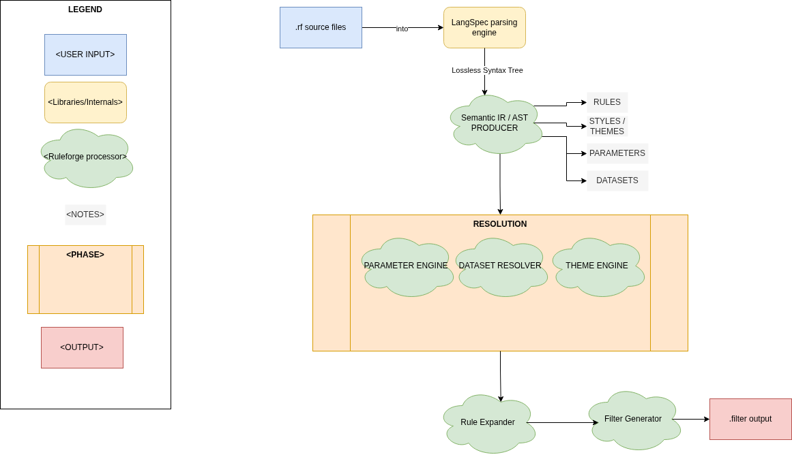

# DESIGN DOCUMENT: Ruleforge

## Table of Contents
1. [Context & Scope](#1-context--scope)
    - [Problem Statement](#11-problem-statement)
    - [Goals](#12-goals)
    - [Non-Goals](#13-non-goals)
    - [Future Considerations](#14-future-considerations)
    - [Design Philosophy](#15-design-philosophy)
2. [System Architecture](#2-system-architecture)
    - [High-Level Overview](#21-high-level-overview)
    - [Domain Model](#22-domain-model)
    - [Execution Model](#23-execution-model)
3. [DSL & Rule Engine](#3-dsl--rule-engine)
    - [DSL Structure](#31-dsl-structure)
    - [Rule Composition](#32-rule-composition)
4. [System Characteristics](#4-system-characteristics)
    - [Safety & Validation](#41-safety--validation)
    - [Performance & Scale](#42-performance--scale)
    - [Extensibility](#43-extensibility)
5. [Lifecycle & Operations](#5-lifecycle--operations)
    - [Versioning & Game Updates](#51-versioning--game-updates)
6. [Alternatives Considered](#6-alternatives-considered)

---

## 1. Context & Scope
Ruleforge targets technically inclined PoE players comfortable with configuration languages or programming concepts. Its main goal is having one source to compile into multiple filters (filter families); automation.

### 1.1 Problem Statement
At present, the best known filter engine is NeverSink et al.'s `FilterBlade`, which is an amazing piece of software. However, it is heavily UI-based, and for the developer like me, this is not very efficient or fun. Alternatively, one could write their own loot filters manually, but this is very tedious.

Ruleforge aims to fill the gap for like-minded developers playing Path of Exile, who want advanced control over their loot filter but not manually write the `.filter` files. We offer a programmatic approach to write loot filters, with a powerful and expressive, but non-verbose, DSL (domain-specific language) to write filters.

### 1.2 Goals

**Language & Syntax Design**
* Ruleforge should be powerful and flexible.
* Ruleforge must not be overly verbose; elegancy is preferred.
* Ruleforge must be concise and clear, not ambiguous. 
* While ruleforge is not strictly a GPL (general-purpose programming language), it does provide imperative programming mechanisms for advanced functionality (such as loops and user-defined functions).
    * Loops are mostly intended for iteration over datasets.
* Ruleforge will allow interfacing with the base `.filter` syntax explicitly, meaning users can inject raw `filter` blocks manually if they want.
* The language does *not* have side-effects outside of the compilation process.
    * This means 0 file or system access.

**Architecture & Engine Capabilities**
* The internal ruleforge engine must be architecturally well-designed such that maintainability and extensibility is straightforward.
* The Ruleforge language must support at a minimum all available features of the PoE1 filter engine.
* Compiling a `.rf` file will be extremely fast even for large filters (with over 30k lines in the `.filter` output).
* A ruleforge filter will be mostly deterministic: a single `.rf` filter will compile always into the same overall `.filter` file, BUT some features affect it.
    * For example, when one uses the economy data to automatically tier items, re-runs will cause items to be in different locations.

**Filter Management & Datasets**
* A single `.rf` file must be able to compile into multiple `.filter` files automatically based on parameters, for example strictnesses, themes, etc.
    * These parameters influence the compilation pipeline.
    * Thus ruleforge must minimize filter maintenance effort as much as possible.
* Ruleforge must provide built-in mechanics for commonly used features, defined within ruleforge itself.
    * This means ruleforge must have an import-export mechanism, not just for rulesets but also for features such as templates and functions.
    * Ruleforge will define the standard library inside ruleforge itself.
* Ruleforge provides built-in datasets for the game's types, which the user is possible to extend and/or override.
* Filters should remain maintainable across league updates with minimal changes.
    * Ruleforge's internal datasets will automatically update without needing a `ruleforge` client update.

**Developer Experience (DX) & Tooling**
* Ruleforge has compiler-grade error messages for its `.rf` files, allowing the development of highly complex filters without resurfacing bugs.
* Ruleforge has a module which allows users to paste an item configuration from the game and see exactly which rules would apply.
    * This is mainly intended for debugging user `.rf` filters.
    * This module will show *both* the `.rf` sections and the compiled `.filter` sections.
* If a new version of the DSL will break old `.rf` files, there will be a migration tool to automatically update the user `.rf` file in a new output.
* During the compilation process, the engine will give comprehensive reports of progress.

### 1.3 Non-Goals

**Scope Boundaries**
* For the foreseeable future, no UI is made.
* No other games will be supported.
* `.rf` is not intended to be used to integrate with other tools from the start.
    * However, such features might be developed over time.
* Ruleforge will not support runtime editing while in-game.
* Ruleforge will not attempt to simulate the full Path of Exile game economy or drop system.

**Target Audience & Intent**
* Ruleforge is **not** intended to replace `FilterBlade`.
* Ruleforge is also not intended for casual players, although they are free to use the tool.
* Ruleforge is not meant to replace player decisions in game, only to provide clear feedback signals.

### 1.4 Future Considerations (Maybes)
* If possible, Ruleforge will provide a mechanism (i.e., through parameters) to adjust certain filter sections based on the current character progress in-game.
    * I have to do more research about whether this is possible with the game's APIs and filter capabilities.

### 1.5 Design Philosophy
Ruleforge's architecture is guided by the following core principles:

**1. Explicit over Implicit (No "Magic"):**<br/>
Code must be predictable. Implicit behaviors create hard-to-find bugs and impossible edge cases. The compiler will not inject hidden conditions, group unrelated rules, or alter the logical outcome of the user's definitions. Any compiler-driven optimizations (such as reordering conditions for game engine efficiency) must preserve exact logical equivalence and remain transparent to the user.

**2. Absolute Traceability & Inspectability:**<br/>
A developer must always be able to map a compiled `.filter` output directly back to its `.rf` source. Ruleforge guarantees this traceability. To further this principle, the standard library itself is written in native `.rf` files rather than hardcoded into the compiler, allowing users to inspect, learn from, and trace core abstractions.

**3. Domain Clarity over Turing Completeness:**<br/>
Ruleforge is a Domain-Specific Language, not a General-Purpose Language. Features are strictly scoped to the needs of evaluating and filtering game items. While imperative concepts like loops and variables exist to reduce boilerplate when iterating over datasets, the language restricts features that do not serve the domain, prioritizing filter maintainability over raw computational power. 

**4. Strict Separation of Concerns:**<br/>
To keep complex configurations readable, Ruleforge enforces a semantic boundary between logic, presentation, and data. Rule definitions, visual styling (colors, sounds, map icons), and item datasets are distinctly separated and managed within the language.

**5. Composable by Default:**<br/>
Filters must be built from reusable, modular blocks rather than copy-pasted definitions. Ruleforge actively encourages the DRY (Don't Repeat Yourself) principle by providing robust internal systems for `templates`, `modules`, `functions`, and `import/export` mechanics, drastically reducing the maintenance burden across league updates.

---

## 2. System Architecture

## 2. System Architecture

### 2.1 High-Level Overview


Ruleforge operates as a specialized, multi-pass compiler. It transforms high-level `.rf` source files into raw Path of Exile `.filter` files through a strict pipeline:

1. **Frontend (Parsing):** The engine utilizes the LangSpec library, driven by a `ruleforge.lspec` grammar definition, to parse `.rf` files into a Lossless Syntax Tree (LST).
2. **Middle-end (Semantic Analysis & Resolution):** The LST is transformed into a semantic Intermediate Representation (IR). During this phase, processors resolve imports, validate scope and access levels, link style references to themes, and evaluate datasets.
3. **Backend (Expansion & Emission):** The rule expander cross-references the resolved IR with user-defined compilation parameters (e.g., strictness levels) to generate a flattened list of `FilterBlocks`. Finally, the filter generator emits the deterministic `.filter` files.

*Reference:* [LangSpec Repository](https://github.com/LordMartron94/Langspec)

### 2.2 Domain Model

The system's internal state is modeled across three distinct boundaries:

**1. Structural & Language Entities (The DSL)**
* **Namespace:** A logical grouping of Modules used to prevent naming collisions during imports.
* **Module:** The primary unit of encapsulation. A bundle of Rulesets, Themes, Templates, Functions, and Datasets. Modules enforce a strict, binary **Access Boundary**: members are either explicitly marked to `export` (publicly consumable by other modules) or remain entirely private to the module by default.
* **Ruleset:** A named, reusable bundle of Rules. Rulesets can define *Core Conditions* that automatically apply to all child rules unless explicitly overridden.
* **Dataset:** A programmatic collection of game items (engine-defined or user-defined) used to generate rules for large item groups without repetition.

**2. Behavioral & Styling Entities (The Logic)**
* **Rule:** The core logical unit. Unlike a standard PoE filter block, a Rule in Ruleforge is a complex node containing multiple condition chains, parameters, and actions. A single Rule can expand into multiple standard `.filter` blocks.
* **Condition:** A boolean predicate required for a rule's action to trigger.
* **Action:** The terminal outcome of a rule (e.g., `show`, `hide`).
* **Style & Theme:** A `Style` dictates the visual/audio rendering of an item in-game. A `Theme` is a bundled collection of `Styles` sharing the same names. Swapping Themes allows one `.rf` file to compile into vastly different visual filters.
* **Template:** A parameterized rule blueprint. A low-level primitive used to stamp out similar rules with varying inputs.
* **Function:** An imperative AST generator. Unlike templates, functions support complex logic (iteration, condition branching) to generate complex rulesets dynamically.

**3. Game & Compilation Entities (The Output)**
* **Game Type Manifest:** The internal type system representing Path of Exile's filter conditions (e.g., `ItemLevel` as Integer, `BaseType` as String Array). This is strictly required for the semantic analyzer to validate user input against the PoE engine's capabilities.
* **Filter Block:** The raw, flattened representation of a single PoE1 filter entry generated during the expansion phase.
* **Generated Filter:** The final collection of Filter Blocks, packaged with specific parameters (strictness, theme) ready for disk emission.

### 2.3 Execution Model

The Ruleforge compilation pipeline is a staged, synchronous execution model. State mutation is strictly confined to advancing the Intermediate Representation through these phases:

**Phase 1: Initialization & Parsing**<br/>
&nbsp;&nbsp;&nbsp;&nbsp;1. **Load Configuration:** Read environment flags, target parameters (strictness, themes), and base configurations.<br/>
&nbsp;&nbsp;&nbsp;&nbsp;2. **Initial Parse:** Parse the entrypoint `.rf` source into an LST.<br/>
&nbsp;&nbsp;&nbsp;&nbsp;3. **Dependency Resolution:** Walk the initial LST to discover `import` statements. Recursively fetch and parse imported `.rf` files to build a complete dependency graph.<br/>

**Phase 2: Semantic Analysis**<br/>
&nbsp;&nbsp;&nbsp;&nbsp;4. **Build Semantic Model:** Transform the aggregate LST into the initial IR.<br/>
&nbsp;&nbsp;&nbsp;&nbsp;5. **Load Datasets:** Inject built-in game datasets and parse user-overridden datasets.<br/>
&nbsp;&nbsp;&nbsp;&nbsp;6. **Validation & Linking:** Resolve style references, validate access modifiers across namespaces, and type-check conditions against the Game Type Manifest.<br/>

**Phase 3: Expansion & Generation**<br/>
&nbsp;&nbsp;&nbsp;&nbsp;7. **Evaluate Logic:** Execute user-defined Functions and Templates, iterating over datasets to generate concrete Rule instances.<br/>
&nbsp;&nbsp;&nbsp;&nbsp;8. **Rule Expansion:** Apply the runtime parameters (e.g., strictness) to the Rules. Flatten complex condition chains into discrete, standard PoE `Filter Blocks`.<br/>
&nbsp;&nbsp;&nbsp;&nbsp;9. **Emit Artifacts:** Write the resulting `Generated Filter` objects to the filesystem as `.filter` files.<br/>

---

## 3. DSL & Rule Engine

### 3.1 DSL Structure

```ruleforge
// core.rf example

version "1.0.0";
module test.core; // Namespace and module defined instantly

// Define the contract
export themeSchema BaseTiering {
    godTier;
    poopTier;
}

// Internal to this file by default (no export keyword)
colorSet Palette {
    DEFAULT = r255 g255 b255 a240;
}

// Implement the contract
export theme DefaultTheme implements BaseTiering {
    godTier {
        onShow { Background r255 g255 b255 a240; }
        onHide { 
            Background Palette.DEFAULT override a90; 
            Border Palette.DEFAULT; 
        }
    }
}

// Themes can extend other themes allowing to override only parts of them (and add new keys if needed)
export theme AltTheme extends DefaultTheme {
	override godTier {
        onShow { 
			Background Palette.DEFAULT override a90; 
            Border Palette.DEFAULT; 
        }        
        onHide { Background r255 g255 b255 a240; }		
	}
}

// Templates are just functions that return a rule block
template BaseRule(baseType string, godStyle style, poopStyle style) {
    scope {
        baseType = $baseType;
    }
    
    // Explicit baseline
    baseline {
        action show;
        style $godStyle;
    }

    variants {
        // Explicitly inherits baseline action (show), overrides style
        when areaLevel >= 90 {
            inherit action;
            style $poopStyle;
        }
        // Completely overrides baseline
        when @strictness >= 3 {
            action hide;
            style $godStyle; 
        }
    }
}

export ruleset Currency {
    description "Currency rules evaluated top-to-bottom";

    coreConditions {} // core conditions empty, this ruleset does not have any conditions that apply on every rule

    // Replaced priority +3 with raw lexical ordering. 
    // This executes first.
    rule ExaltedOrb {
        scope { baseType = "Exalted Orb"; }
        action show;
        style DefaultTheme.godTier;
    }

    // This executes second. Uses the template.
    rule GenericCurrency = BaseRule("<baseType>", DefaultTheme.godTier, DefaultTheme.poopTier);
}

// -----------------------------------------------
// main.rf example

version "1.0.0";
module entry;

import test.core;

// Configuration block clearly separated
configuration {
    default-schema = core.BaseTiering;
    default-theme = core.DefaultTheme;

    adapter FancySchema -> core.BaseTiering {
        fancyMythic = godTier; 
        fancyPoop = poopTier;
    }
}

// Execution order is explicitly determined by inclusion order here. No arbitrary priority numbers.
export func main() {
    // 1. Core currency evaluated first
    include core.Currency; 

    // 2. Custom ruleset injected second, overriding the theme adapter inline
    include test.other.Weapons with {
        theme: FancyTheme,
        adapter: FancySchema
    };
}

```

The Ruleforge DSL is a statically-scoped, domain-specific configuration language. It is designed around C-style block structures `{}` to encapsulate logic, enforcing a strict separation between domain data (items/conditions), presentation (themes/styles), and composition logic (templates/rulesets). 

**Lexical Anatomy & Semantics**
* **Access Modifiers:** The language operates on a strict binary access model. Entities are private to their defining module by default. The `export` keyword explicitly exposes an entity to the public namespace.
* **Variable Interpolation:** User-defined template parameters are strictly evaluated using the `$` prefix (e.g., `$baseType`). 
* **Compiler Directives:** Built-in compilation context variables, such as user-selected strictness levels, are accessed via the `@` prefix (e.g., `@strictness`).
* **Explicit Inheritance:** Overriding behavior requires explicit declaration. When generating variants inside a rule or template, the `inherit` keyword must be used to carry over baseline actions (e.g., `inherit action;`); otherwise, the variant is treated as a complete overwrite.

**Abstract Syntax Tree (AST) Mapping**
When the LangSpec engine parses a `.rf` file, it maps the syntax into a strongly typed AST. To illustrate, parsing the `BaseRule` template from the core module generates the following hierarchical node structure:

```text
TemplateDeclaration
├── Identifier: "BaseRule"
├── Parameters
│   ├── Param: "baseType" (Type: String)
│   ├── Param: "godStyle" (Type: StyleRef)
│   └── Param: "poopStyle" (Type: StyleRef)
└── Body (Block)
    ├── ScopeDeclaration
    │   └── Assignment: "baseType" = VarRef("$baseType")
    ├── BaselineDeclaration
    │   ├── Action: SHOW
    │   └── Style: VarRef("$godStyle")
    └── VariantsDeclaration
        ├── VariantNode
        │   ├── Condition: BinaryExpr(VarRef("areaLevel"), ">=", Int(90))
        │   ├── ActionInherit
        │   └── StyleOverride: VarRef("$poopStyle")
        └── VariantNode
            ├── Condition: BinaryExpr(CompilerVar("@strictness"), ">=", Int(3))
            ├── ActionOverride: HIDE
            └── StyleOverride: VarRef("$godStyle")
```

This structured LST (Lossless Syntax Tree) guarantees that the semantic analyzer has the exact lineage of every inherited action and overridden style before it attempts to flatten the logic.

### 3.2 Rule Composition

Rule interaction in Ruleforge is governed by the absolute constraints of the underlying Path of Exile engine: filters execute strictly top-to-bottom, and the *first matched rule terminates evaluation for that item*.

Ruleforge enforces composition through **Lexical Cascade**.

**1. Global Ordering & Priority**
The exact sequence of the compiled `.filter` file is dictated entirely by the inclusion order in the entrypoint's `main` function. 
* If `include core.Currency;` is declared before `include test.other.Weapons;`, every rule within the Currency ruleset will be evaluated by the PoE client before any Weapon rule. 
* Within a specific `ruleset`, the sequence of `rule` declarations defines the local execution order.

**2. Shadowing & Conflict Resolution**
Because the first match wins, shadowing is a critical structural mechanism:
* **Rule Shadowing:** If Rule A matches `BaseType "Exalted Orb"` at line 10, and Rule B matches the same at line 50, Rule B is logically unreachable (dead code). The Ruleforge compiler will flag unreachable rules during the Semantic Analysis phase as warnings, but will emit them in the exact order specified.
* **Namespace Shadowing:** If a user defines a local `Theme` with the same identifier as an imported `Theme`, the local definition explicitly shadows (overwrites) the imported one for that file's context.

**3. Structural Composition (Themes & Schemas)**
Styles are composed via interfaces rather than being hardcoded into rules:
* **Contracts:** A `themeSchema` defines the visual requirements (e.g., `godTier`, `poopTier`).
* **Implementation:** A `theme` implements that schema. Themes can extend other themes (`extends DefaultTheme`), overriding specific blocks while inheriting the rest. 
* **Adapters:** If a ruleset expects `Schema A` but the user provides a theme built on `Schema B`, an `adapter` block maps the style references at compilation time, ensuring type-safety.

**4. Variant Expansion**
When a rule or template defines `variants`, the compiler flattens these into distinct, sequential PoE filter blocks. 
* Variants are evaluated in the order they are defined within the block. 
* If a variant matches a specific compiler context (e.g., `when @strictness >= 3`), that variant replaces or precedes the baseline block in the final output depending on the logical gate.
* Use of the `inherit` keyword ensures that only specific properties are changed while maintaining the baseline's intent.

---

## 4. System Characteristics

### 4.1 Safety & Validation

Ruleforge splits validation into two strict boundaries: Syntactic (Offline/Absolute) and Semantic (Data-Driven/Permissive).

**1. Syntactic Validation (Strict)**
The language is strictly typed at the parser level. The grammar enforces data types for all operators and conditions. If a rule condition requires an integer (e.g., `ItemLevel >= "High"`), the compiler immediately halts and emits a fatal syntax error with exact line/column tracing. 

**2. Semantic Entity Validation (Permissive)**
To validate whether game entities (BaseTypes, Modifiers, Classes) actually exist, Ruleforge relies on a locally cached **Game Type Manifest**, aggregated periodically from sources like `poe.ninja` and the Path of Building repository. 
* **Zero Network Dependency at Compile Time:** The compiler evaluates against the local manifest only, ensuring deterministic, offline, and instant execution.
* **Warning-Based Emittance:** Because external APIs cannot guarantee 100% real-time accuracy (especially during a new league launch), the compiler will *never* halt on an unrecognized game entity. It will emit a compilation warning, allowing the user to override the check and inject the rule anyway.

### 4.2 Performance & Scale
Ruleforge is designed to compile massive, 30,000+ line `.filter` outputs in seconds. It achieves this by optimizing both the frontend parsing and the backend expansion phases.

**1. Frontend (Parsing & Memory)**
The parsing pipeline avoids Garbage Collection overhead by utilizing manual arena-based memory allocation ([Memforge](https://github.com/LordMartron94/Memforge)). The lexing phase operates in linear time $O(N)$ using a minimized DFA ([Autarch](https://github.com/LordMartron94/Autarch) / [Lexarch](https://github.com/LordMartron94/Lexarch)), while the parsing engine ([Syntaxa](https://github.com/LordMartron94/Syntaxa)) uses highly optimized recursive descent. The result is near-instantaneous ingestion of `.rf` source files.

**2. Backend (Rule Expansion Complexity)**
The primary performance bottleneck in a filter generator is the exponential growth of AST nodes during Dataset iteration. Ruleforge mitigates this by:
* **Reference Sharing:** Identical style blocks and unmodified templates share memory references rather than being deeply cloned during variant expansion, drastically reducing the memory footprint when expanding loops.

### 4.3 Extensibility

The Ruleforge core engine is domain-agnostic regarding the specific conditions and actions of Path of Exile. It does not hardcode game logic; it operates on a strict **Registry Pattern**.

**Internal Registries**
To add a newly introduced PoE mechanic, future engineers do not need to modify the parser or the core expansion logic. 
* **ConditionRegistry:** Maps a string literal (e.g., `waystoneTier`) to its expected internal data type (e.g., `Integer`) and its string-emittance format for the final `.filter` file.
* **ActionRegistry:** Registers valid terminal actions (e.g., `Show`, `Hide`, `Continue`).
* **StyleRegistry:** Defines valid styling properties (e.g., `SetBorderColor`, `PlayAlertSound`) and their required parameter constraints.

This decoupled architecture means updating the engine for new league mechanics is often as simple as updating a JSON configuration file or adding a single registration line in the compiler's initialization phase.

---

## 5. Lifecycle & Operations

### 5.1 Versioning & Game Updates
Path of Exile introduces massive economy and itemization changes every 3 to 4 months. Ruleforge's update lifecycle is decoupled into two distinct streams to handle this reality:

**1. Language Engine Versioning (The `version` directive)**
Changes to the `.rf` syntax, AST generation, or core compilation mechanics require a new SemVer release of the Ruleforge compiler. 
* To prevent breaking user scripts, every `.rf` file explicitly declares its target version (e.g., `version "1.0.0";`).
* If a user upgrades the compiler but runs an older `.rf` file, the engine will either parse it using legacy compatibility modes or provide a mechanized migration script to rewrite the `.rf` source to the modern syntax.

**2. Game Manifest Updates (The League Cycle)**
When Grinding Gear Games adds new BaseTypes (e.g., "Waystones") or removes old mechanics, the Ruleforge engine does *not* need a binary update. 
* The Game Type Manifest (the dictionary of valid PoE entities) is an external data artifact.
* If a user's filter references a removed entity (e.g., a deprecated Prophecy), the Semantic Analyzer will flag it as an "Orphaned Entity Warning" rather than a fatal compilation error, ensuring that older filters can still compile for new leagues while the user updates their `.rf` source.

---

## 6. Alternatives Considered

Building a custom Domain-Specific Language and compiler is an expensive engineering endeavor. We evaluated several existing paradigms before committing to the Ruleforge architecture:

**1. UI-Based Generators (e.g., FilterBlade)**
* **Evaluation:** FilterBlade is the gold standard for 99% of the player base. It provides a visual interface for tiering and styling.
* **Rejection Reason:** It fails the "Developer Experience" test. For power users managing tens of thousands of items across highly specific economy strategies, clicking through UI menus is tedious, un-versionable, and violates DRY (Don't Repeat Yourself) principles. It cannot be managed purely via Git.

**2. General Purpose Scripts (Python/Lua string concatenation)**
* **Evaluation:** Writing a Python script that loops over data and prints `.filter` text is trivial and highly extensible.
* **Rejection Reason:** Zero domain safety. A Python script does not inherently know that Path of Exile's `SetTextColor` requires 3 or 4 integers. It will happily compile garbage text that the PoE client will reject at runtime. Ruleforge's strict Semantic Analyzer catches these domain-specific errors at compile time.

**3. Data Serialization Formats (YAML/JSON to `.filter`)**
* **Evaluation:** Defining the filter logic in massive YAML or JSON files and writing a transpiler.
* **Rejection Reason:** JSON/YAML are data storage formats, not logic formats. They lack native support for control flow, lexical scoping, and template inheritance without building a hideous, verbose pseudo-language inside the JSON keys. Ruleforge's DSL provides ergonomic, C-style syntax explicitly designed for rule composition.